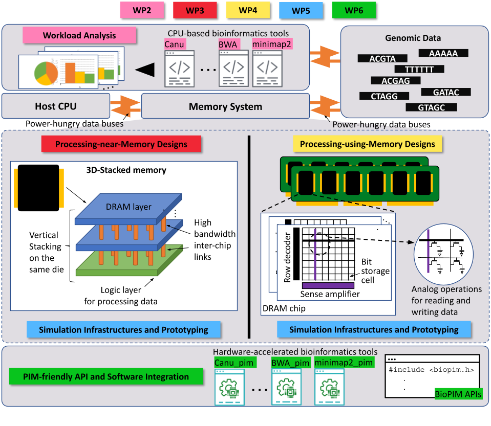

The strategy proposed to achieve the goals of the BioPIM project was based on the completion of 7 work packages (WPs), in 54 months, by 7 partners. The figure below summarizes the aims of the BioPIM WPs.

    

* **Work Package 1** ensured that the project was managed soundly in terms of its administrative, financial and technical progress.
* **Work Package 2** analyzed computational bottlenecks of commonly used bioinformatics/genomics algorithms and popular tools in the field, and the execution time they spent on different components of the computer. Therefore, WP2 guided the hardware and algorithm designs, APIs, and software integration that we developed in the remainder of the work packages.
* **Work Package 3** focused on designing near-memory logic layers to accelerate algorithms that we selected and characterized in WP2.
* **Work Package 4** took an alternate approach of PIM acceleration, where we co-developed hardware/software to perform computation directly on the memory device. We noted that it was also possible to develop PIM acceleration using both strategies that we pursued in WP3 and WP4. Therefore, the activities within these two work packages were carried out in sync.
* **Work Package 5** developed simulation, emulation, and prototyping strategies (using both CPUs and FPGAs) to test the efficiency and correctness of our PIM designs.
* **Work Package 6** focused on practical aspects of this project for external users, where we developed application programming interfaces and software to enable other researchers to take full advantage of our PIM designs.
* **Work Package 7** was dedicated to dissemination and communication activities as well as monitoring the innovation aspects and market potential.
